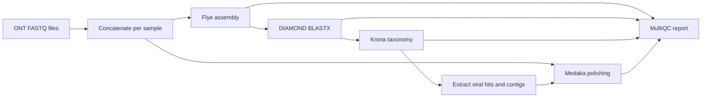

# mattarnoldbio/viral_metagenomics_lite_ont

## Overview

`viral_metagenomics_lite_ont` analyzes Oxford Nanopore long-read FASTQ data. It assembles reads with Flye, searches the resulting contigs against a protein database with DIAMOND BLASTX, summarizes taxonomic assignments with Krona, extracts contigs classified as viral, and polishes those contigs with Medaka using the original reads. MultiQC creates a final report.



## Requirements

- Nextflow (DSL2; the pipeline has been tested with Nextflow 26.04).
- Docker, or another supported Nextflow software profile such as Singularity/Apptainer or Conda.
- A DIAMOND protein database in `.dmnd` format, or a supported BLAST protein database.
- A Krona taxonomy database directory.

The first run downloads the software containers and may take some time. The pipeline has a Docker profile; use `-profile docker` on a machine with Docker available.

This project is independently maintained. It draws on nf-core conventions and uses nf-core modules and infrastructure, but it is not an official nf-core pipeline and does not claim strict nf-core compliance.

## Inputs

Create a CSV samplesheet with a header and one row per sample:

```csv
sample,fastq_dir
SAMPLE_01,/data/project/SAMPLE_01/fastq
SAMPLE_02,/data/project/SAMPLE_02/fastq
```

`sample` is a unique, whitespace-free sample identifier. `fastq_dir` is the path to the directory containing that sample's reads. The pipeline discovers files ending in `.fastq`, `.fastq.gz`, `.fq`, or `.fq.gz`; all matching files in the directory are used. If a sample has multiple FASTQ files, they are concatenated before assembly. Keep unrelated FASTQ files out of the sample directory.

The database parameters are global pipeline inputs, not samplesheet columns:

| Parameter | Required value |
| --- | --- |
| `--diamond_db` | Path or prefix for the DIAMOND/BLAST protein database files. For DIAMOND this is typically the `.dmnd` file. |
| `--krona_db` | Path to the Krona taxonomy database directory. |

## Run

To run directly from GitHub without cloning the repository, use:

```bash
nextflow run mattarnoldbio/viral_metagenomics_lite_ont \
   -profile docker \
   --input ./samplesheet.csv \
   --diamond_db /path/to/protein_db.dmnd \
   --krona_db /path/to/krona/taxonomy \
   --outdir ./results
```

Nextflow will download and cache the pipeline. To run a particular release, add `-r <version>` to the command.

From a local checkout, run:

```bash
nextflow run . \
   -profile docker \
   --input ./samplesheet.csv \
   --diamond_db /path/to/protein_db.dmnd \
   --krona_db /path/to/krona/taxonomy \
   --outdir ./results
```

To run the bundled small test dataset from the repository root:

```bash
nextflow run . \
   -profile docker \
   --input ./assets/testdata/ont_mock/samplesheet.csv \
   --diamond_db ./assets/blastdb/dummy.dmnd \
   --krona_db /path/to/krona/taxonomy \
   --outdir ./results
```

Replace the example Krona path with a taxonomy database installed on your system. For more Nextflow options, including resuming an interrupted run with `-resume`, see the [Nextflow CLI documentation](https://www.nextflow.io/docs/latest/cli.html).

## Pipeline steps

1. Discover the FASTQ files in each sample directory and concatenate multiple files for a sample.
2. Assemble each sample's reads with Flye using ONT raw-read mode.
3. Combine assemblies and run DIAMOND BLASTX against the supplied protein database.
4. Split search results by sample and create Krona taxonomy reports using the supplied taxonomy database.
5. Extract per-sample viral-hit tables and matching viral contig sequences; also create a combined viral-hit table.
6. Polish extracted viral contigs with Medaka using each sample's original reads.
7. Generate a MultiQC report and save pipeline execution metadata.

## Outputs

All result paths below are relative to `--outdir`:

| Directory | Contents |
| --- | --- |
| `assemblies/flye/` | Per-sample Flye draft assemblies (`*.assembly.fasta.gz`). |
| `assemblies/flye/details/` | Flye assembly graphs, assembly information, logs, and parameters. |
| `assemblies/viral_contigs/` | Compressed FASTA files of contigs classified as viral. |
| `assemblies/medaka/` | Medaka-polished viral-contig assemblies. |
| `alignments/diamond/` | Tabular DIAMOND BLASTX results. |
| `taxonomy/krona/` | Krona HTML reports and report assets. |
| `taxonomy/viral_hits/by_sample/` | Per-sample viral-hit CSV files. |
| `taxonomy/viral_hits/` | Combined viral-hit CSV. |
| `quality_control/multiqc/` | MultiQC report, parsed data, and plots when produced. |
| `pipeline_info/` | Nextflow execution reports, trace, DAG, parameters, and software versions. |

The Flye assembly is the draft used for taxonomic searches. The Medaka assembly is a separate polished assembly of the extracted viral contigs. See [docs/output.md](docs/output.md) for the output directory reference and [docs/usage.md](docs/usage.md) for additional Nextflow usage information.

## Credits

`mattarnoldbio/viral_metagenomics_lite_ont` was originally written by Matt Arnold. The pipeline uses Flye, DIAMOND, Krona, Medaka, MultiQC, and Nextflow; see [`CITATIONS.md`](CITATIONS.md) for software references.

## Contributions and Support

If you would like to contribute to this pipeline, please see the [contributing guidelines](docs/CONTRIBUTING.md).

## Citations

An extensive list of references for the tools used by the pipeline can be found in the [`CITATIONS.md`](CITATIONS.md) file.

This pipeline uses code and infrastructure developed and maintained by the [nf-core](https://nf-co.re) community, reused here under the [MIT license](https://github.com/nf-core/tools/blob/main/LICENSE).

> **The nf-core framework for community-curated bioinformatics pipelines.**
>
> Philip Ewels, Alexander Peltzer, Sven Fillinger, Harshil Patel, Johannes Alneberg, Andreas Wilm, Maxime Ulysse Garcia, Paolo Di Tommaso & Sven Nahnsen.
>
> _Nat Biotechnol._ 2020 Feb 13. doi: [10.1038/s41587-020-0439-x](https://dx.doi.org/10.1038/s41587-020-0439-x).
